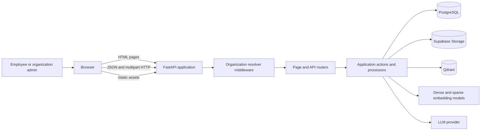
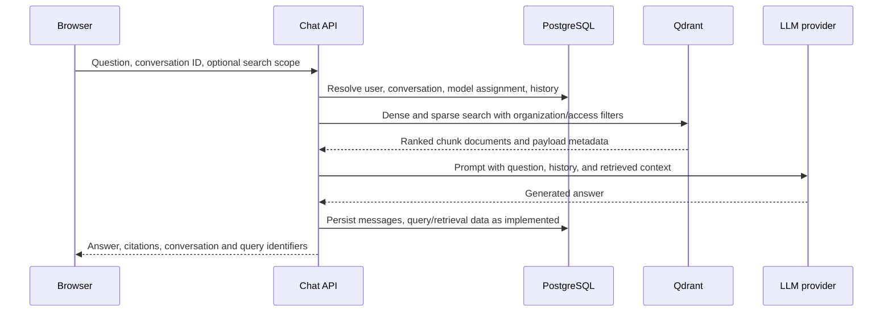

# Architecture

TrustAI is a small monorepo containing a browser client and a Python API. The FastAPI service owns page delivery, authentication, organization-scoped access, RAG orchestration, and integrations with the persistence and model services.

## System context

The browser and API are served from the same FastAPI origin. The client is plain HTML, CSS, and JavaScript in `client/`; it has no JavaScript build or separate client server. PostgreSQL is the source of relational ownership and conversation metadata. Supabase stores original file bytes. Qdrant stores chunk vectors and search payloads. These data stores are separate services and do not participate in one shared transaction.

## Monorepo boundaries

| Area | Responsibility |
|---|---|
| `client/pages/` | HTML entry pages served by `server/app/api/v1/pages.py`. |
| `client/components/` | Page-specific JavaScript and CSS, mounted at `/static`. |
| `server/app/api/v1/` | HTTP handlers and the router registry. The `v1` name is a Python package boundary; current public URLs do not include `/v1`. |
| `server/app/middleware/` | Request-wide organization and user context resolution. |
| `server/app/processors/` | Document loading, OCR, vector operations, storage, and conversation-chain helpers. |
| `server/app/action.py` | Selects an LLM, coordinates retrieval, and prepares answers. |
| `server/app/model.py` | SQLAlchemy ORM declarations. |
| `server/migrations/` | Alembic migration environment and revisions. |
| `docs/` | Architecture, API, UI, relational database, vector database, and contributor process references. |

The canonical ASGI application is `server.app.main:app`. It mounts `client/components` at `/static`, installs `OrgResolverMiddleware`, registers the combined router from `server/app/api/v1/router.py`, and starts the current cleanup coroutine on startup. The root-level `app.py`, `run.py`, and `tasks.py` are legacy files; use the `server.app` package paths documented here and in the README for the current application.

## Request and identity flow

1. FastAPI serves one of the public page routes (`/`, `/start`, `/chat/{conversation_id}`, `/org/register`, `/admin`, or `/admin/dashboard`) or a static asset under `/static`.
2. The browser JavaScript calls the API. Login and signup are public operations; successful responses place the bearer token in browser `localStorage` under `access_token`.
3. `OrgResolverMiddleware` checks the bearer token on protected paths, verifies the JWT, then sets `request.state.org_short_id` and `request.state.user_id`. It also accepts a `token` query parameter for protected file-serving paths.
4. Route dependencies such as `get_current_user` verify the token and resolve the SQLAlchemy `User`. Feature handlers apply ownership, organization, role, and file-scope checks.
5. The handler accesses PostgreSQL through a request-scoped SQLAlchemy session and invokes processors for work that touches files, Qdrant, embeddings, or an LLM.

Middleware context and route authorization are separate layers: a resolved organization ID does not itself grant access to every resource. Page HTML is served without authentication at the middleware layer; the page's API calls and administrative handlers provide the actual data authorization. Review the allowlist and every route-level dependency when changing protected paths.

## Main data flows

### RAG chat

`server/app/action.py` chooses a user-assigned provider when a usable organization key exists, otherwise the configured OpenAI-compatible model, then Ollama as fallback. `chat.py` constructs visibility filters and returns citation metadata alongside the answer. The [backend guide](backend.md) describes routes and exact request fields; [vector-database.md](vector-database.md) describes collection and ranking behavior.

### Document ingestion

The file API validates and hashes an upload, extracts text, splits it into chunks, prepares access and citation metadata, upserts dense and sparse points to the organization's Qdrant collection, uploads original bytes to Supabase, and commits file metadata in PostgreSQL. Since there is no distributed transaction, a failure between those steps can leave partial data. Keep `organization_id`, `document_id`, and access metadata consistent across upload, retrieval, and deletion.

### Administration

Admin pages call organization-scoped endpoints for users, departments, teams, provider keys, model assignments, files, and analytics. The server enforces roles and organization ownership. Browser visibility of an admin tab or button is only presentation; it is not the authorization control.

## Persistence and trust boundaries

- **PostgreSQL:** organizations, users, groups, conversations, messages, file metadata, provider configuration, feedback, and analytics logs.
- **Supabase Storage:** original uploaded bytes, referenced by a storage key in SQL.
- **Qdrant:** per-organization chunk vectors and payloads, including visibility fields used by query filters.
- **Model providers:** external embedding and generation services. Provider credentials come from deployment settings or encrypted organization API-key records.

Do not use a vector payload or a browser-supplied organization identifier as the sole authorization source. Derive tenant context from the verified token, validate resource ownership in SQL, and apply matching Qdrant payload filters. Keep secrets in environment configuration; never put them in client files or documentation.

## Runtime and deployment

The container uses Python 3.12, installs OS packages for PDF/OCR processing, installs `requirements.txt`, copies the repository, and runs `uvicorn server.app.main:app` on port `7860`. Local instructions and required settings are in the [README](../README.md) and [backend guide](backend.md). The background cleanup loop currently logs a daily run but contains placeholder logic; it should not be treated as an active orphan-reconciliation mechanism.
