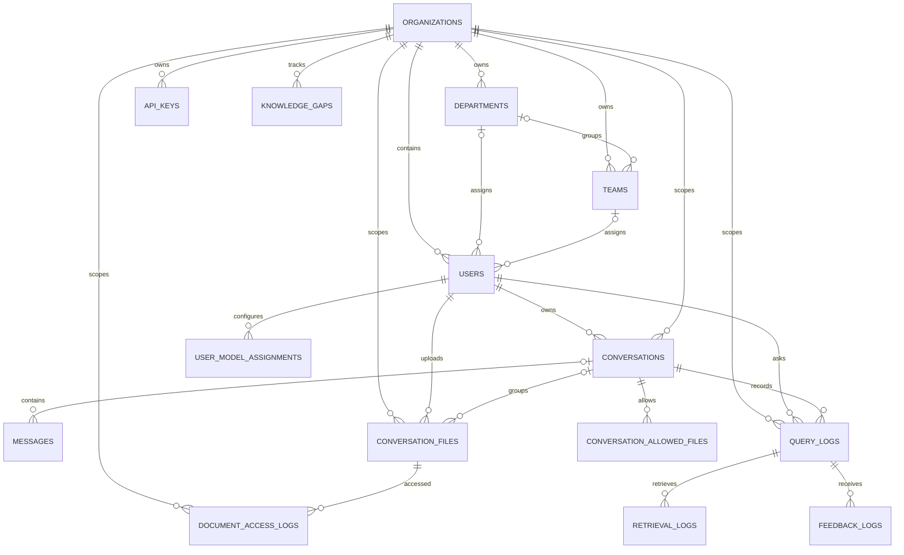

# Database reference

## Overview

The relational database is configured by `DATABASE_URL`. SQLAlchemy model definitions are in `server/app/model.py`; Alembic configuration and revisions are in `server/alembic.ini` and `server/migrations/`.

This document describes the ORM declarations currently in `model.py`. Column defaults such as `default=datetime.utcnow` are Python/SQLAlchemy-side defaults; they are not necessarily database server defaults. Apply and review Alembic revisions when changing schema. Do not assume editing a model updates an already deployed database.

### Entity relationships

The diagram shows foreign-key relationships. Some associations are intentionally represented by strings or metadata rather than normalized foreign keys: for example, `ConversationFile.department` and `.team` store names, and Qdrant vectors are outside this relational schema.

## Tables

### `organizations`

Stores a tenant and its registration/contact information.

| Column | Type | Nullability | Meaning / default |
|---|---|---|---|
| `id` | Integer | Not null, primary key | Internal organization ID. |
| `org_id` | String(50) | Not null, unique | Short organization identifier used in tokens and routing. |
| `name` | String(100) | Not null | Organization name. |
| `email` | String(100) | Not null | Organization contact email. |
| `phone` | String(20) | Nullable | Contact phone. |
| `website` | String(200) | Nullable | Website URL. |
| `industry` | String(100) | Nullable | Industry label. |
| `size` | String(20) | Nullable | Organization size label. |
| `country` | String(100) | Nullable | Country. |
| `state` | String(100) | Nullable | State/region. |
| `city` | String(100) | Nullable | City. |
| `address` | Text | Nullable | Street/mailing address. |
| `domain` | String(100) | Not null, unique | Email domain associated with the organization. |
| `status` | String(20) | Nullable | Defaults to `active`. |
| `created_at` | DateTime | Nullable | Defaults to current UTC time in ORM. |
| `updated_at` | DateTime | Nullable | Defaults to current UTC time; ORM updates on modification. |
| `deleted_at` | DateTime | Nullable | Soft-deletion timestamp; no default. |

### `departments`

Organization-owned departments. `uq_org_dept` prevents duplicate department names within one organization.

| Column | Type | Nullability | Meaning / default |
|---|---|---|---|
| `id` | Integer | Not null, primary key | Department ID. |
| `organization_id` | Integer | Not null, FK → `organizations.id` | Organization owner; FK has `ON DELETE CASCADE`. |
| `name` | String(100) | Not null | Department name. |
| `description` | String(255) | Nullable | Optional description. |
| `created_at` | DateTime | Nullable | ORM default: current UTC time. |

### `teams`

Organization-owned teams, optionally assigned to a department. `uq_org_team` makes team names unique within an organization.

| Column | Type | Nullability | Meaning / default |
|---|---|---|---|
| `id` | Integer | Not null, primary key | Team ID. |
| `organization_id` | Integer | Not null, FK → `organizations.id` | Owner; FK has `ON DELETE CASCADE`. |
| `department_id` | Integer | Nullable, FK → `departments.id` | Parent department; FK has `ON DELETE SET NULL`. |
| `name` | String(100) | Not null | Team name. |
| `description` | String(255) | Nullable | Optional description. |
| `created_at` | DateTime | Nullable | ORM default: current UTC time. |

### `users`

Tenant membership, profile, role, and password hash. Email is globally unique in this schema, not unique only within an organization.

| Column | Type | Nullability | Meaning / default |
|---|---|---|---|
| `id` | Integer | Not null, primary key | User ID. |
| `organization_id` | Integer | Not null, FK → `organizations.id` | Tenant; FK has `ON DELETE CASCADE`. |
| `email` | String(100) | Not null, unique, indexed | Login email. |
| `name` | String(100) | Not null | Display name. |
| `password_hash` | String(256) | Not null | Werkzeug password hash; never store the plaintext password here. |
| `department_id` | Integer | Nullable, FK → `departments.id` | Department; FK has `ON DELETE SET NULL`. |
| `team_id` | Integer | Nullable, FK → `teams.id` | Team; FK has `ON DELETE SET NULL`. |
| `role` | String(50) | Nullable | ORM default: `employee`. Code also checks roles such as `org_admin`, `super_admin`, and `department_manager`. |
| `mobile` | String(20) | Nullable | Optional phone. |
| `designation` | String(100) | Nullable | Job title/designation. |
| `created_at` | DateTime | Nullable | ORM default: current UTC time. |

ORM relationships `department` and `team` point to the corresponding rows through their foreign-key columns.

### `conversations`

User-owned chats with organization and optional department/team visibility context.

| Column | Type | Nullability | Meaning / default |
|---|---|---|---|
| `id` | String(36) | Not null, primary key | UUID string generated by the ORM. |
| `organization_id` | Integer | Not null, FK → `organizations.id` | Tenant; FK has `ON DELETE CASCADE`. |
| `user_id` | Integer | Not null, FK → `users.id` | Owner; FK has `ON DELETE CASCADE`. |
| `name` | String(100) | Nullable | ORM default: `New chat`. |
| `department_id` | Integer | Nullable, FK → `departments.id` | Optional department context; FK has `ON DELETE SET NULL`. |
| `team_id` | Integer | Nullable, FK → `teams.id` | Optional team context; FK has `ON DELETE SET NULL`. |
| `scope` | String(50) | Nullable | ORM default: `private`. |
| `created_at` | DateTime | Nullable | ORM default: current UTC time. |
| `updated_at` | DateTime | Nullable | ORM default and ORM update: current UTC time. |

Indexes: `idx_conv_user(user_id)` and `idx_conv_org(organization_id)`. ORM relationships expose the department and team.

### `messages`

Conversation messages and optional citation payloads.

| Column | Type | Nullability | Meaning / default |
|---|---|---|---|
| `id` | Integer | Not null, primary key | Message ID. |
| `conversation_id` | String(36) | Nullable, FK → `conversations.id` | Parent conversation; FK has `ON DELETE CASCADE`. Nullable to permit messages without a conversation. |
| `role` | String(20) | Not null | Message role, such as `user` or `bot`. |
| `content` | Text | Not null | Message text. |
| `citations` | JSON | Nullable | Structured citations attached to assistant messages. |
| `timestamp` | DateTime | Nullable, indexed | ORM default: current UTC time. |

### `conversation_files`

Relational metadata for uploaded files. File bytes are stored externally (Supabase); vectors/chunks are stored in Qdrant.

| Column | Type | Nullability | Meaning / default |
|---|---|---|---|
| `id` | Integer | Not null, primary key | File metadata ID. |
| `organization_id` | Integer | Not null, FK → `organizations.id` | Tenant; FK has `ON DELETE CASCADE`. |
| `conversation_id` | String(36) | Nullable, FK → `conversations.id` | Optional associated conversation; FK has `ON DELETE CASCADE`. |
| `user_id` | Integer | Not null, FK → `users.id` | Uploading user; no explicit `ON DELETE` action declared. |
| `filename` | String(255) | Not null | Stored/generated filename. |
| `original_filename` | String(255) | Nullable | User-provided filename. |
| `access_level` | String(20) | Nullable | ORM default: `private`; code uses private, team, department, and company scopes. |
| `file_path` | String(512) | Not null | Storage key/path, not necessarily a local filesystem path. |
| `file_size` | Integer | Nullable | File size in bytes. |
| `file_hash` | String(64) | Nullable | SHA-256 digest used for duplicate checks. |
| `department` | String(100) | Nullable | Department name metadata. |
| `team` | String(100) | Nullable | Team name metadata. |
| `gdrive_file_id` | String(255) | Nullable | Legacy/public URL or external file identifier used by serving code. |
| `document_id` | String(50) | Nullable, indexed | Identifier used to associate the record with vector payloads. |
| `uploaded_at` | DateTime | Nullable | ORM default: current UTC time. |

Index: `idx_file_org(organization_id)`.

### `api_keys`

Encrypted organization-level provider credentials. The encryption key is configured separately with `ENCRYPTION_KEY`.

| Column | Type | Nullability | Meaning / default |
|---|---|---|---|
| `id` | Integer | Not null, primary key | Key record ID. |
| `organization_id` | Integer | Not null, FK → `organizations.id` | Owner; FK has `ON DELETE CASCADE`. |
| `provider` | Enum `ProviderEnum` | Not null | Provider: `openai`, `anthropic`, `google`, or `ollama`. |
| `api_key_encrypted` | String(500) | Not null | Fernet-encrypted provider key. |
| `description` | String(200) | Nullable | Human-readable label. |
| `is_active` | Boolean | Nullable | ORM default: `true`. |
| `created_at` | DateTime | Nullable | ORM default: current UTC time. |

### `user_model_assignments`

Provider/model selection for an individual user. `uq_user_provider` allows only one row per user/provider pair. `ProviderEnum` exposes lowercase API values (`openai`, `anthropic`, `google`, `ollama`); the tracked initial migration declares the PostgreSQL enum labels as uppercase member names (`OPENAI`, `ANTHROPIC`, `GOOGLE`, `OLLAMA`).

| Column | Type | Nullability | Meaning / default |
|---|---|---|---|
| `id` | Integer | Not null, primary key | Assignment ID. |
| `user_id` | Integer | Not null, FK → `users.id` | Assigned user; FK has `ON DELETE CASCADE`. |
| `provider` | Enum `ProviderEnum` | Not null | Provider enum value. |
| `model_name` | String(100) | Not null | Provider-specific model identifier. |
| `is_active` | Boolean | Nullable | ORM default: `true`. |
| `created_at` | DateTime | Nullable | ORM default: current UTC time. |

### `query_logs`

One row per logged RAG query, including timing, token/cost estimates, retrieval counts, and feedback fields.

| Column | Type | Nullability | Meaning / default |
|---|---|---|---|
| `id` | Integer | Not null, primary key | Query log ID. |
| `organization_id` | Integer | Not null, FK → `organizations.id` | Tenant; FK has `ON DELETE CASCADE`. |
| `user_id` | Integer | Not null, FK → `users.id` | Querying user; no explicit `ON DELETE` action declared. |
| `conversation_id` | String(36) | Not null, FK → `conversations.id` | Conversation; no explicit `ON DELETE` action declared. |
| `question` | Text | Not null | Original user question. |
| `rewritten_question` | Text | Nullable | Standalone/rewritten query if recorded. |
| `answer` | Text | Nullable | Generated answer. |
| `retrieved_chunks` | Integer | Nullable | ORM default: `0`. |
| `retrieval_time_ms` | Float | Nullable | Retrieval duration in milliseconds. |
| `generation_time_ms` | Float | Nullable | Generation duration in milliseconds. |
| `total_time_ms` | Float | Nullable | End-to-end duration in milliseconds. |
| `confidence_score` | Float | Nullable | Application-computed confidence/similarity summary. |
| `input_tokens` | Integer | Nullable | Input token count, if available. |
| `output_tokens` | Integer | Nullable | Output token count, if available. |
| `estimated_cost_usd` | Float | Nullable | Estimated provider cost in USD. |
| `user_feedback` | String(10) | Nullable | Compact rating value stored with the query. |
| `feedback_comment` | Text | Nullable | Optional feedback comment. |
| `created_at` | DateTime | Nullable, indexed | ORM default: current UTC time. |

Indexes: `idx_query_org(organization_id)` and `idx_query_user(user_id)`.

### `retrieval_logs`

Optional per-result retrieval details associated with a query.

| Column | Type | Nullability | Meaning / default |
|---|---|---|---|
| `id` | Integer | Not null, primary key | Retrieval log ID. |
| `query_log_id` | Integer | Not null, FK → `query_logs.id` | Parent query; FK has `ON DELETE CASCADE`. |
| `chunk_id` | String(100) | Nullable | Vector/chunk identifier. |
| `document_id` | String(50) | Nullable | Source document identifier. |
| `similarity_score` | Float | Nullable | Similarity/relevance score. |
| `chunk_text_preview` | Text | Nullable | Stored preview of the retrieved chunk. |

### `document_access_logs`

Audit events for file access/actions.

| Column | Type | Nullability | Meaning / default |
|---|---|---|---|
| `id` | Integer | Not null, primary key | Access log ID. |
| `organization_id` | Integer | Not null, FK → `organizations.id` | Tenant; FK has `ON DELETE CASCADE`. |
| `file_id` | Integer | Not null, FK → `conversation_files.id` | File; FK has `ON DELETE CASCADE`. |
| `user_id` | Integer | Not null, FK → `users.id` | Acting user; no explicit `ON DELETE` action declared. |
| `action` | String(50) | Nullable | Access/action name. |
| `ip_address` | String(45) | Nullable | IPv4 or IPv6 address text. |
| `user_agent` | String(255) | Nullable | Request user-agent text. |
| `created_at` | DateTime | Nullable | ORM default: current UTC time. |

Index: `idx_doc_access_org(organization_id)`.

### `feedback_logs`

Individual feedback records associated with a query. This table complements the compact feedback fields on `query_logs`.

| Column | Type | Nullability | Meaning / default |
|---|---|---|---|
| `id` | Integer | Not null, primary key | Feedback record ID. |
| `query_log_id` | Integer | Not null, FK → `query_logs.id` | Parent query; FK has `ON DELETE CASCADE`. |
| `rating` | String(20) | Nullable | Rating label, for example `helpful` or `not_helpful`. |
| `comment` | Text | Nullable | Optional feedback text. |
| `created_at` | DateTime | Nullable | ORM default: current UTC time. |

### `knowledge_gaps`

Questions that could not be adequately answered and their resolution state.

| Column | Type | Nullability | Meaning / default |
|---|---|---|---|
| `id` | Integer | Not null, primary key | Knowledge-gap ID. |
| `organization_id` | Integer | Not null, FK → `organizations.id` | Tenant; FK has `ON DELETE CASCADE`. |
| `question` | Text | Not null | Question that exposed the gap. |
| `occurred_count` | Integer | Nullable | ORM default: `1`. |
| `last_occurred` | DateTime | Nullable | ORM default: current UTC time. |
| `resolved` | Boolean | Nullable | ORM default: `false`. |
| `resolved_at` | DateTime | Nullable | Resolution timestamp. |
| `resolved_by` | Integer | Nullable, FK → `users.id` | User who resolved it; no explicit `ON DELETE` action declared. |

### `conversation_allowed_files`

Join-style allowlist that restricts which document IDs may be used in a conversation. `uq_conv_allowed` prevents duplicate document IDs within one conversation.

| Column | Type | Nullability | Meaning / default |
|---|---|---|---|
| `id` | Integer | Not null, primary key | Allowlist row ID. |
| `conversation_id` | String(36) | Not null, FK → `conversations.id` | Conversation; FK has `ON DELETE CASCADE`. |
| `document_id` | String(50) | Not null | Allowed document identifier. |

## Constraints and indexes at a glance

- Unique organization identifiers: `organizations.org_id`, `organizations.domain`.
- Unique department/team names per organization: `uq_org_dept`, `uq_org_team`.
- Globally unique indexed user email: `users.email`.
- Conversation lookup indexes: `idx_conv_user`, `idx_conv_org`.
- File lookup indexes: `conversation_files.document_id` and `idx_file_org`.
- Unique model provider per user: `uq_user_provider`.
- Query indexes: `query_logs.created_at`, `idx_query_org`, `idx_query_user`.
- Retrieval children are deleted with their query; feedback children are deleted with their query.
- Organization-owned departments, teams, conversations, files, keys, query logs, document access logs, and knowledge gaps declare cascading organization foreign keys where noted above.

## Vector and object storage boundary

PostgreSQL stores ownership, conversation history, file metadata, logs, and access-control references. Supabase stores uploaded file bytes. Qdrant stores dense/sparse vector representations and retrieval payloads. These services do not share a relational transaction, so ingestion/deletion logic must keep the SQL metadata, object storage object, and Qdrant document IDs in sync.

## Migrations

Alembic revisions under `server/migrations/versions/` are the migration history. Review generated operations and data implications before applying a revision. Keep ORM and migration changes aligned. `server/migrations/recreate_chats.py` drops and recreates chat-related tables and is destructive; it is not a routine migration path.

### ORM and migration compatibility note

The current ORM declares `conversations.id` as `String(36)` with UUID strings, and its related conversation foreign keys use `String(36)`. The checked-in initial Alembic revision creates these IDs/foreign keys as integers. Later revisions add `messages.citations`, `conversation_files.gdrive_file_id`, and nullable message conversation IDs, but they do not convert the conversation primary key or dependent foreign keys from integer to string. As a result, the ORM declarations and the tracked migration schema are not fully aligned for a database created only from the checked-in revisions.

Before creating a new database or applying future revisions to an existing one, inspect the live schema and Alembic revision state. A type conversion affects primary/foreign keys and existing data, so it needs an explicit reviewed migration or a verified baseline strategy; do not assume `--autogenerate` will safely perform the conversion. The current model tables above document the ORM side, while the revision files document the historical migration side.
